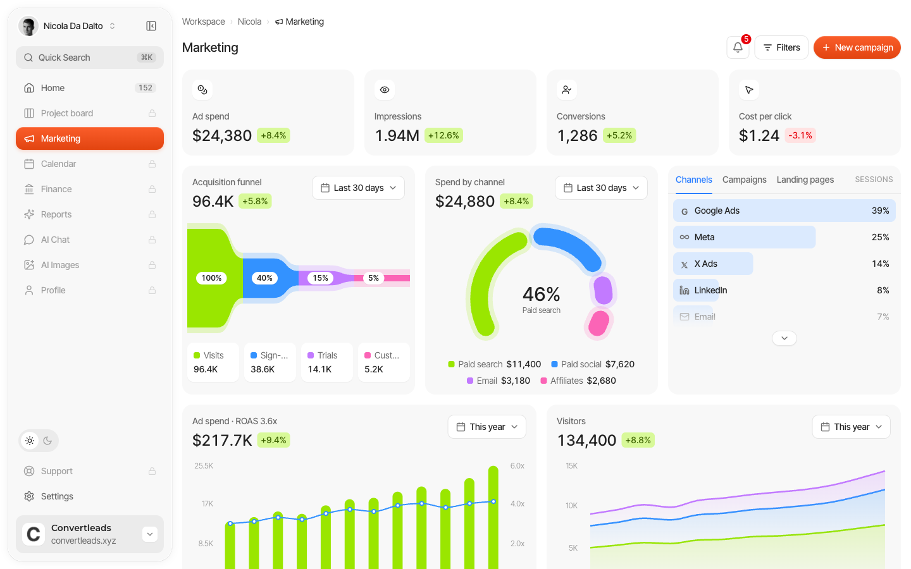

# Convertleads Dashboard

A free, open-source dashboard UI kit: two dashboard templates, seven animated charts and 30+ components. Built with Next.js 15, Tailwind CSS v4 and Recharts. Light and dark themes.

**Live demo:** [convertleads.xyz/dashboard](https://www.convertleads.xyz/dashboard)



Every number in the demo is fake. Hover any chart and the card's headline number follows your cursor. Every filter (Weekly / Monthly / Yearly, Last 7 / 30 / 90 days, This year / Last year) swaps in its own data set.

## What's inside

### Templates

| Page | Path | What it shows |
|---|---|---|
| Home | `src/app/page.tsx` | Recent hires, earnings bars, revenue line, contributions heatmap, KPIs, orders table |
| Marketing | `src/app/marketing/page.tsx` | KPIs, acquisition funnel, spend gauge, sessions by source, ad spend + ROAS, stacked visitors, campaigns table |
| Settings | `src/components/settings/` | Modal with General, Profile, Tools (MCP servers) and Storage (drag-and-drop upload + file table) |
| Login | `src/app/login/page.tsx` | Demo sign-in screen |

### Charts (`src/components/charts/`)

All charts take the same three props, `data`, `active` and `onActive`, so a parent can react to the hovered point.

| Component | Use it for |
|---|---|
| `HoverBars` | Rounded bars that rise in one by one; the hovered bar highlights |
| `HoverArea` | Smooth line or stacked area with a guide line instead of a tooltip |
| `ComboBarLine` | Bars on the left axis, a line on the right (e.g. spend + ROAS) |
| `Gauge` | 250° segmented gauge, segments draw in one after another |
| `Funnel` | Flowing funnel where each stage tapers into the next |
| `Heatmap` | GitHub-style activity grid |
| `RankedBars` | Tabbed share bars with an expand toggle for extra rows |

### Dashboard blocks (`src/components/dashboard/`)

- `StatChartCard`: a card whose headline number follows the hovered chart point, with a period switch. This is the piece that ties a chart to its header.
- `KpiCard` / `KpiRow`, `StatHead`, `PageHeader`

### UI components (`src/components/ui/`)

`Button`, `IconButton`, `Card`, `Tile`, `Chip`, `Delta`, `Badge`, `CountUp` (animated numbers), `Segmented`, `Tabs`, `Picker`, `SearchField`, `Switch`, `Modal`, `LegendTile`, `Pagination`, `Avatar`, `useIndicator` (the sliding highlight behind tabs and menus).

### App shell (`src/components/shell/`)

Collapsible sidebar (full width or icons only), light/dark toggle with no flash on load, account menu, phone tab bar.

## Use it

```sh
git clone https://github.com/ljkhgjvchf/template-dashboard.git
cd template-dashboard
npm install
npm run dev        # http://localhost:3000/dashboard
```

**Take one component.** Each folder has an `index.ts`, so you can copy a folder into your own Next.js + Tailwind v4 project and import from it:

```tsx
import { HoverBars } from "@/components/charts";
import { StatChartCard } from "@/components/dashboard";

<StatChartCard label="Revenue" periods={revenueByPeriod} fmt={usd}>
  {({ series, active, setActive }) => (
    <HoverBars data={series.points} active={active} onActive={setActive} />
  )}
</StatChartCard>
```

Copy the tokens and keyframes from `src/app/globals.css` along with it. Colours, shadows and motion all come from there.

**Plug in real data.** Replace the files in `src/data/`. A series is just `{ points: [{ x: "Jan", v: 1200 }, ...], delta: "+4.2%" }`.

**Rebrand.** Edit the tokens at the top of `src/app/globals.css`. The light theme sits in `@theme`, the dark theme in `:root[data-theme="dark"]`.

**Run at the root path.** The app is served at `/dashboard`. To serve it at `/`, set `BASE_PATH` to `""` in `src/lib/base.ts`.

## Good to know

- Sign-in is demo only. Any email and password works, and the state lives in the browser (`src/components/shell/auth.ts`). Swap in real auth before you use this with real data.
- Settings and profile edits are saved in the browser's `localStorage`. Storage uploads are simulated: files never leave the browser.
- Motion respects the visitor's reduced-motion setting.

## Credits

The layout and interaction design are inspired by [BoardUI](https://www.boardui.com)'s dashboard templates. All code here was written from scratch; no BoardUI code or assets are included. Fonts: Inter Tight and Montserrat (SIL Open Font License) via Fontsource.

## License

The code is MIT licensed, see [LICENSE](LICENSE). As [NOTICE](NOTICE) says, the Convertleads name and logo (`public/brand/`, `src/app/icon.png`, `src/app/apple-icon.png`) and the profile photo (`public/nicola.jpg`) are not covered by the MIT licence. Swap them for your own when you reuse the kit.

Made by [Convertleads](https://www.convertleads.xyz).
